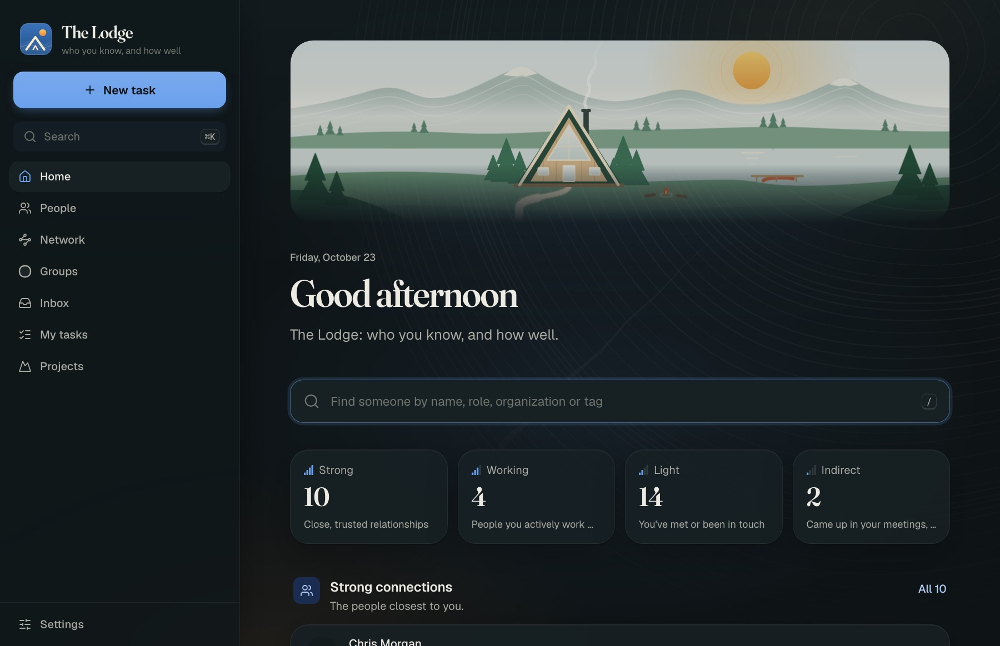

# The Lodge

A local-first relationship CRM for one person, on the Mac: who you know, how well you know them, how they're
connected, and everything you've learned about them along the way. Drop in notes, documents, spreadsheets and
meetings and it files what they say under the right people. It runs on your Mac, or with the AI you choose: a local
model through Ollama, a cloud AI with your own key, or a mix, and the first run recommends one from your Mac's memory.
Your people stay on your computer unless you send them somewhere, and **Lockdown** makes sure nothing is sent. The full specs are under
[Features](#features); the download page is at [therealeminem.github.io/TheLodge](https://therealeminem.github.io/TheLodge/).



## Install (Mac)

1. Download **TheLodge-x.y.z-arm64.dmg** from the [latest release](https://github.com/TheRealEminem/TheLodge/releases/latest).
   It needs an Apple silicon Mac (M1 or newer) on macOS 14 or later.
2. Open it and drag **The Lodge** to **Applications**, then open The Lodge.
3. **First open only:** this build isn't signed by an Apple developer yet, so macOS blocks it. Go to
   System Settings → Privacy & Security, scroll down, and press **Open Anyway** next to "The Lodge" was blocked.
   (Terminal alternative: `xattr -dr com.apple.quarantine "/Applications/The Lodge.app"`.)
4. A short setup opens on first launch: your name, where AI should run (on this Mac, in the cloud, or a mix; it
   recommends one for your Mac and can install [Ollama](https://ollama.com) and a model for you), and whether to turn
   on Lockdown. Then add your people by hand, or import a spreadsheet or your LinkedIn connections.

The Lodge lives in your menu bar (a small A-frame) and opens its window on launch. Everything it needs is inside
the app: its own Python, the server and the web app. It updates itself from **Settings → Updates** or the menu bar;
turn on **Beta updates** there to get new versions a few days early, and **Go back** returns to the version you had.

**Where things are kept:** `~/Library/Application Support/The Lodge` holds your people, notes, settings and keys
(readable only by you), plus `logs/server.log`. A backup is made there every hour something changes, and a few are
kept: the newest, and one from about an hour, a day and a week ago. Deleting the app leaves them alone; updating is
just replacing the app. [INSTALL.md](INSTALL.md) has the rest: Granola and calendars, backups and restore, and what
to do if something's wrong.

## Features

**Your people**
- People and organizations with what you know about them, where you met, who they work with, tags, and every
  note and meeting in order on their profile.
- **How well:** each person is a strong, working, light or indirect connection, and Home shows how many of each
  you have, with the people closest to you first. Find anyone from Home by name, role, organization or tag.
- **One of everyone.** People who are probably the same person are flagged, with the reason, for you to merge.
  Merges move meetings, notes and relationships across, and every one can be undone.

**Your network**
- **Rings of closeness:** you at the centre, a ring for each tier, and the people on each ring gathered into
  wedges by organization. Switch a group on to make it a wedge, point at someone to see their ties, or find the
  paths to a person you'd like to meet and who could introduce you. The same people are also a free-laid map
  (groups pull their people together) and a list.
- **Ask the network:** ready-made questions (who do you know at…, investors and advisors, everyone from an event,
  follow-ups waiting), and lists on request: ask "who do I know in climate tech?" and the AI writes the list from
  your own book.

**Getting things in**
- **Notes that file themselves.** Paste notes or drop in documents (Word, PDF, PowerPoint, text, Markdown, HTML,
  RTF, OpenDocument). The AI picks out the people, organizations, relationships and facts and files them; anything
  it isn't sure of waits in the **Inbox** for you to check.
- **Spreadsheets**, with the AI matching their columns to your fields for you to check, and **LinkedIn**'s own
  Connections export.
- **Meetings come to you.** Connect [Granola](https://granola.ai) and new meetings arrive every 15 minutes with
  their summary and transcript, matched to your people by email. Connect a calendar's private iCal address and
  meetings with people you know go on your book too. Everything either one adds can be taken back in one step.
- **A sheet others can add to.** Share a Google Sheet so people without the app can read, correct and add to your
  people; it's kept in step both ways.

**Knowing more**
- **AI on every profile:** an overview of what you know about someone, and questions about them ("what should I
  follow up on?", "who do we both know?") answered from what's on file.
- **Sediment Analysis:** how someone seems to feel about you, your company, someone else or a product you describe,
  read by AI from what's on file (notes, meetings and, if you allow it, what they said in transcripts). Each reading
  gives a stance from very cool to very warm, how sure it is, and dated evidence marked quoted or paraphrased, checked
  against your records. Readings of the same thing stack up as layers, so you can see a feeling change over time.
  It also writes a **portrait** of each person (how they talk, what they care about, how they seem to see you, what's
  left open) and lets you **rehearse** a conversation with them: the AI plays them from that portrait and your records,
  underlines anything it makes up, and shows what each reply rests on. It always says it's a simulation, never makes
  up anything about someone's health, family, money or private life, and nothing it writes goes back into your people.
- **Research.** Flag people you'd like to know better; The Lodge researches them with Gemini and Google Search
  (as a half-price batch by default) and files the brief on their profile. Or copy a research brief into Gemini
  Deep Research and bring the reports back in bulk.

**Tasks**
- My tasks, projects and a board. Action items found in notes and meetings become tasks, linked back to where
  they came from.

**Your data**
- One SQLite file on your Mac. Hourly backups that roll over (the newest, and one from about an hour, a day and a
  week ago), **Back up now**, **Restore** (which keeps a backup of how things were first, so it can be undone) and
  **Export** to readable JSON (Settings → Your data).
- Any AI: Ollama (local), Claude, OpenAI, Gemini, DeepSeek or any OpenAI-compatible API. Keys are typed into
  Settings, never into a file, and are never sent back to the page. A key entered in one Trailmix family app is
  there for the others on the same Mac.
- **On this Mac or in the cloud:** the first run reads your Mac's memory and recommends a path. A small local model
  writes summaries, action items, overviews and answers; reading long documents for relationships and facts is
  better with a cloud AI, so the careful job can use one while everything else stays here ("Mixed").
- **Lockdown** (Settings → Privacy): nothing leaves the computer. Only AI that runs here answers, the app doesn't
  check for updates by itself, and research by Gemini, Granola, calendars, the shared Sheet and Gravatar pictures
  stop. Everything on your own data keeps working.
- **Pictures:** add one to anyone by choosing, dropping or pasting an image, or let The Lodge look people up on
  Gravatar (off until you turn it on).

## Build the app yourself

```bash
scripts/build-app.sh          # -> dist-app/The Lodge.app
scripts/build-app.sh --dmg    # -> "dist-app/The Lodge-<version>-arm64.dmg" as well
scripts/install-app.sh        # check, build, test, back up, and replace the copy in /Applications
```

Needs an Apple silicon Mac, the Xcode command line tools, Node 18+ and internet access (the Python runtime is
downloaded once into `build/cache`). The version is in `VERSION`; the name, port (8791), bundle ID and data folder
are in `app.json`. `scripts/install-app.sh` keeps the previous app in `build/previous-app.noindex/` and puts it back
if anything fails.

## Run from source

```bash
scripts/dev      # the server on :8791 (reloads on Python changes) and the web app on http://localhost:5173
scripts/check    # tests, types, build and style rules: run before you commit
```

Requires Python 3.11+ and Node 18+. The first run sets up `.venv` and `node_modules`. Data goes in `./data` unless
`LODGE_DATA_DIR` says otherwise; to try things without touching your real people, point it at an empty folder and
load the fictional demo network with `curl -X POST localhost:8791/api/crm/admin/demo` (`DELETE` removes it).

**Self-hosting.** The same server runs on Linux in Docker, without the Mac app; sign-in turns on when
`APP_ACCESS_TOKEN` is set:

```bash
docker build -t lodge . && docker run -p 8790:8790 -v lodge-data:/data -e APP_ACCESS_TOKEN=… lodge
```

## How it's built

The Lodge is a [Trailmix](https://github.com/TheRealEminem/trailmix)-family app: a Python (FastAPI) server and a
React web app in one process on `127.0.0.1:8791`, shown in a small Swift menu bar app that bundles its own Python.
Its features are modules (`modules/crm` for people, `modules/tasks` for tasks) on a shared host (`core/`), so the
family's apps can later become one app. [ARCHITECTURE.md](ARCHITECTURE.md) is the host and module contract,
[DESIGN.md](DESIGN.md) is the look, and [TRAILMIX.md](TRAILMIX.md) is what has to stay compatible with Trailmix.

For an AI agent working on it:

> Before changing anything, read ARCHITECTURE.md and DESIGN.md in full, then core/server/module.py,
> core/web/registry.ts and modules/crm. Put new features in a module (scripts/new-module), follow the rules in
> ARCHITECTURE.md §3, never import one module from another (use events, contracts, links and search through the
> host), and run scripts/check before you finish.

## Releasing

The way Trailmix ships: every version goes out as a beta first, and becomes the release everyone gets a few days
later. GitHub builds and publishes it (free for a public repo); day to day, `scripts/install-app.sh` still builds
on this Mac. The download page is `docs/index.html`, served by GitHub Pages, and its button always fetches the
newest full release.

1. Set `VERSION` (say `0.4.0`), commit and push, then tag that commit:
   ```bash
   git tag v0.4.0 && git push origin v0.4.0
   ```
   `.github/workflows/release.yml` builds it, runs the updater smoke test and publishes a pre-release: the disk
   image, its checksum (the updater checks it) and `TheLodge-arm64.dmg`, the copy the download page links to.
2. People with **Beta updates** on are offered it right away.
3. Every day `.github/workflows/promote.yml` makes the newest beta the full release once it's been out 3 days, unless
   an open issue is labelled `blocks release`. Then everyone is offered it, and the download page serves it. To
   promote one sooner, run "Promote beta" in the Actions tab with its tag, or `scripts/promote-beta.sh v0.4.0`.

## License

GNU Affero General Public License v3.0 (AGPL-3.0), copyright (C) 2026 The Lodge contributors; see [LICENSE](LICENSE).
The app bundles the Geist, Geist Mono and Fraunces fonts (SIL OFL) and other open-source packages under their own
licenses.
